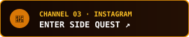

<!--
  ╔══════════════════════════════════════════════════════════════════════════╗
  ║  OPERATOR      : SUMIT [SEMANTIC_SUMIT]                                  ║
  ║  ROLE          : FOUNDER & CTO · SYSTEM & PRODUCT ARCHITECT             ║
  ║  EXPERTISE   : THE BRAIN · THE VOICE · THE MACHINE · THE LAB          ║
  ║  DESIGN        : FULL-WIDTH ANIMATED VECTOR CYBERDECK (DESKTOP + MOBILE) ║
  ╚══════════════════════════════════════════════════════════════════════════╝
-->

  <picture>
    <source media="(max-width: 1024px)" srcset="./assets/mobile/hero_simple_mobile.svg">
    <source media="(min-width: 1025px)" srcset="./assets/hero_simple.svg">
    
  </picture>
  <picture>
    <source media="(max-width: 1024px)" srcset="./assets/mobile/pillars_header_mobile.svg">
    <source media="(min-width: 1025px)" srcset="./assets/pillars_header.svg">
    
  </picture>
  <picture>
    <source media="(max-width: 1024px)" srcset="./assets/mobile/card_brain_mobile.svg">
    <source media="(min-width: 1025px)" srcset="./assets/card_brain.svg">
    
  </picture>
  <picture>
    <source media="(max-width: 1024px)" srcset="./assets/mobile/card_voice_mobile.svg">
    <source media="(min-width: 1025px)" srcset="./assets/card_voice.svg">
    
  </picture>
  <picture>
    <source media="(max-width: 1024px)" srcset="./assets/mobile/card_machine_mobile.svg">
    <source media="(min-width: 1025px)" srcset="./assets/card_machine.svg">
    
  </picture>
  <picture>
    <source media="(max-width: 1024px)" srcset="./assets/mobile/card_lab_mobile.svg">
    <source media="(min-width: 1025px)" srcset="./assets/card_lab.svg">
    
  </picture>
  <picture>
    <source media="(max-width: 1024px)" srcset="./assets/mobile/footer_simple_mobile.svg">
    <source media="(min-width: 1025px)" srcset="./assets/footer_simple.svg">
    
  </picture>

  
  
  
  

